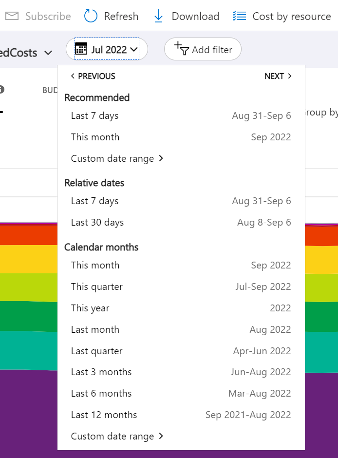
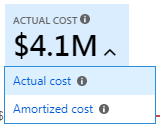
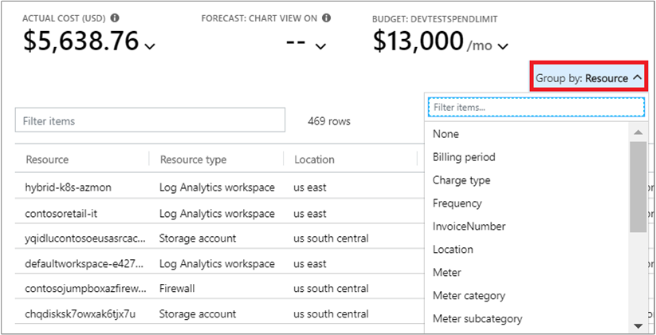
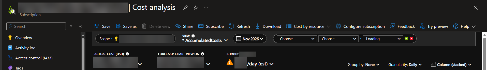
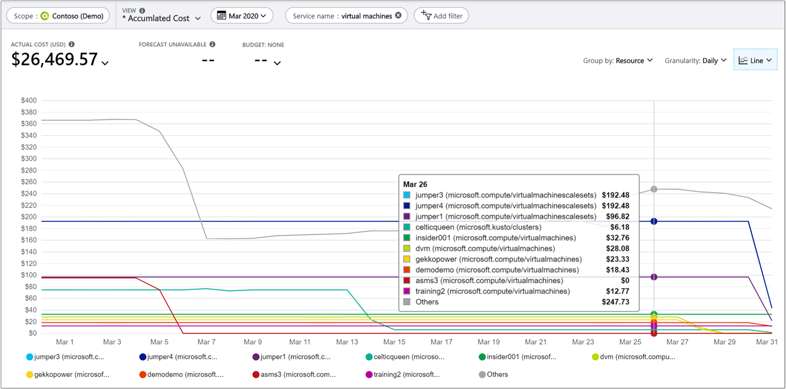
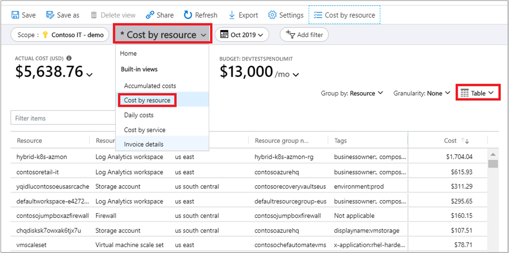
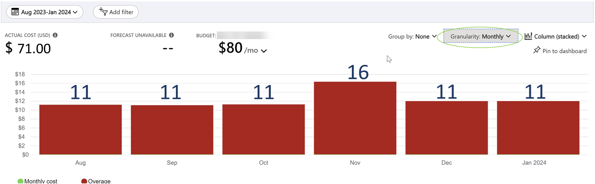
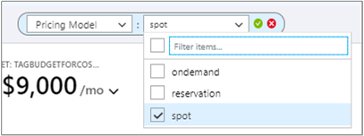
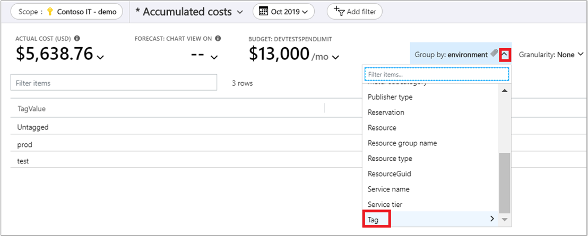

# Azure Virtual Machines: Daily Cost and Billed Usage

Costa Rica

[](https://github.com/)
[](https://github.com/) [Cloud2BR OSS - Learning Hub](https://github.com/Cloud2BR-MSFTLearningHub)

Last updated: 2026-11-16

----------

## Overview

Use **Cost analysis** to see how VM costs change by day. For the **billed compute quantity**, download or export the detailed usage records, select the VM compute meter measured in hours, and convert the decimal hours to hours and minutes. A Cost Management query can return daily costs, but it does not replace the detailed records needed for the quantity.

> [!IMPORTANT]
> Billing data, resource IDs, and exported files can be sensitive. This guide uses placeholders, public Microsoft Learn images, and a portal reference. No subscription identifiers or billing values are published. Do not publish unredacted portal screenshots, account or subscription IDs, resource names, invoices, tokens, or downloaded reports.

<details>
<summary><b>Table of Contents</b> (Click to expand)</summary>

- [References](#references)
- [Before You Start](#before-you-start)
- [View Daily VM Cost in the Portal](#view-daily-vm-cost-in-the-portal)
  - [Open and Configure the Analysis](#open-and-configure-the-analysis)
  - [Apply and Remove Filters](#apply-and-remove-filters)
  - [Nine Useful Portal Views](#nine-useful-portal-views)
  - [Save, Reopen, and Download a View](#save-reopen-and-download-a-view)
- [Download Detailed Cost and Usage](#download-detailed-cost-and-usage)
- [Get Billed Hours and Minutes by Day](#get-billed-hours-and-minutes-by-day)
- [Worked Example](#worked-example)
- [REST API: Query Daily Costs](#rest-api-query-daily-costs)
- [REST API: Get Detailed Usage](#rest-api-get-detailed-usage)
- [Understand the Result](#understand-the-result)
- [Troubleshooting](#troubleshooting)

</details>

<a id="references"></a>
<details markdown="1">
<summary><b>References</b> (Click to expand)</summary>

- [Monitor costs for virtual machines](https://learn.microsoft.com/en-us/azure/virtual-machines/cost-optimization-monitor-costs)
- [Understand Azure VM usage](https://learn.microsoft.com/en-us/azure/virtual-machines/vm-usage)
- [Understand cost details fields](https://learn.microsoft.com/en-us/azure/cost-management-billing/automate/understand-usage-details-fields)
- [Group and filter in Cost Analysis](https://learn.microsoft.com/en-us/azure/cost-management-billing/costs/group-filter)
- [Customize Cost Analysis views](https://learn.microsoft.com/en-us/azure/cost-management-billing/costs/customize-cost-analysis-views)
- [Common Cost Analysis uses](https://learn.microsoft.com/en-us/azure/cost-management-billing/costs/cost-analysis-common-uses)
- [Create Cost Management exports](https://learn.microsoft.com/en-us/azure/cost-management-billing/costs/tutorial-improved-exports)
- [Query API](https://learn.microsoft.com/en-us/rest/api/cost-management/query/usage?view=rest-cost-management-2025-03-01)
- [Generate Cost Details Report API](https://learn.microsoft.com/en-us/rest/api/cost-management/generate-cost-details-report/create-operation?view=rest-cost-management-2025-03-01)

**Image credits:** The eight local `learn-*.png` screenshots are unmodified public examples from Microsoft Learn's **Customize Cost Analysis views** and **Common Cost Analysis uses**, linked in their captions. Copyright Microsoft; reproduced under [CC BY 4.0](https://creativecommons.org/licenses/by/4.0/) as provided by the [Azure documentation license](https://github.com/MicrosoftDocs/azure-docs/blob/main/LICENSE). They show Microsoft's example names, dates, and costs, not your subscription. The existing public images and portal reference are identified separately in their captions. Portal layouts can change.

</details>

## Before You Start

- Choose the subscription and date range. Use a completed billing period when possible; open-period costs can change.
- Ensure that your identity can read cost data at the chosen scope. **Cost Management Reader** is a starting point for Azure RBAC scopes; billing-account permissions and the agreement's charge-visibility settings can also apply. See [assign access to Cost Management data](https://learn.microsoft.com/en-us/azure/cost-management-billing/costs/assign-access-acm-data).
- Identify the VM and its resource ID in the portal. Keep this value private and use it only in your own analysis.
- To create an export, check the [export and storage permissions](https://learn.microsoft.com/en-us/azure/cost-management-billing/costs/tutorial-improved-exports#prerequisites). Downloading invoice-level usage can require separate billing roles.

## View Daily VM Cost in the Portal

### Open and Configure the Analysis

1. Sign in to the [Azure portal](https://portal.azure.com/). Search for **Subscriptions**, open the subscription containing the VM, and select **Cost Management > Cost analysis** in its left menu. Alternatively, search for **Cost Management**, open **Cost analysis**, and use **Scope** to select the subscription.
2. Verify **Scope** before adding filters. Subscription scope is a useful starting point for comparing VMs. A resource-group scope excludes costs outside that group; a billing scope can include multiple subscriptions.
3. Open the **View** selector. For the configurable chart walkthrough below, select a classic view such as **Accumulated costs** or **Cost by resource**, where available. Some portal versions expose **Resources**, **Resource groups**, **Services**, and **Reservations** as separate smart views. Their layouts and controls differ; do not expect every chart control in every smart view.
4. Open the date selector next to the view name. Choose **Last month** for a completed calendar month, or **Custom** and enter the start and end dates for your investigation. Apply the dates. Use the same date range throughout the comparison.
5. Open the metric selector beside the cost total and choose **Actual cost** for the first pass. Check the displayed currency. Use **Amortized cost**, where supported, only when you intentionally want allocated reservation or savings-plan costs rather than the actual-cost view.
6. Above the main chart, open **Granularity > Daily**. Each column now represents a UTC day, not the running total. **Accumulated** includes previous days, **Monthly** groups by calendar month, and **None** shows a total for the whole selected period.
7. Open the chart-type selector, which may currently say **Area**, and choose **Column (stacked)**. Use **Line** to compare trends or **Table** to inspect aggregated values. The name of the selected saved view can still say "Accumulated costs" after you change its granularity.
8. Add the filters below, then choose a grouping. Wait for the chart to refresh after each change and recheck the scope, dates, metric, currency, and active filter pills before interpreting the result.

> [!NOTE]
> Daily is the lowest cost granularity in this portal view; it does not show hours, minutes, or exact VM start/stop times. Daily charts support up to 92 consecutive days; selecting a longer period can switch the view to Monthly and adjust the dates. Obtain compute quantities from the detailed usage records later in this guide.



*Steps 4 and 8: choose a common analysis period. Public Microsoft Learn example from [Select a date range](https://learn.microsoft.com/en-us/azure/cost-management-billing/costs/customize-cost-analysis-views#select-a-date-range); the dates are illustrative.*



*Step 5: select the cost basis before comparing results. Public Microsoft Learn example from [Switch between actual and amortized cost](https://learn.microsoft.com/en-us/azure/cost-management-billing/costs/customize-cost-analysis-views#switch-between-actual-and-amortized-cost); the amount is not from your subscription.*

### Apply and Remove Filters

1. Select **Add filter** above the chart.
2. In the attribute list, search for or choose **Service name** (called **Meter category** in some contexts).
3. Open the value list and select **Virtual Machines**. Confirm with **Apply** or the checkmark if the portal shows one.
4. Select **Add filter** again, choose **Resource**, search for the VM, and select it. If names repeat, first filter **Resource group**, and verify the full resource identity against the VM's **Properties > Resource ID** privately.
5. For a compute-usage investigation, optionally add **Charge type > Usage**, where available. Remove this filter when investigating purchases or refunds; otherwise those charges are intentionally excluded.
6. To change a filter, select its pill and edit its values. To remove it, use the pill's remove control. Before trying a different recipe below, remove filters that no longer belong to that recipe.

Multiple selected values within one include filter broaden that attribute's selection; filters on different attributes narrow the result together. For example, **Service name = Virtual Machines** plus **Resource group = rg-demo** shows the VM-service costs in that group, not all services in that group. Available values also depend on earlier filters, dates, scope, and currency. An empty value list is not proof that the resource never incurred cost.

| Filter | Example selection | What to check |
| --- | --- | --- |
| Service name / Meter category | Virtual Machines | Focuses on the VM service; it does not include every disk, network, backup, or licensing charge for a workload. |
| Resource | The selected VM | Match the resource identity, not only its display name. Deleted resources can still have historical costs. |
| Resource group | The workload's group | Includes only charges attributed to that group, not dependencies elsewhere. |
| Resource type | The VM resource type, when listed | Useful for identifying VM resources; do not assume it selects the same meter set as Service name. |
| Meter / Meter subcategory | A meter from the selected VM's charges | Helps investigate size, tier, or software-related charges. Confirm the underlying compute meter and hour unit in cost details. |
| Pricing model | OnDemand, Spot, Reservation, or SavingsPlan, when offered | Keep the metric consistent; zero actual usage cost can still have billed usage quantity. |
| Location | A region present in the usage data | A resource-location grouping is not a guarantee of where every dependent service is billed. |
| Tag | An existing workload or environment tag and value | Untagged or unsupported charges can be excluded. Tags are not retroactive and resource-group tags are not automatically resource tags. |

Use **Group by** to split the selected costs into categories; it does not itself exclude categories. For example, filter to one VM and group by **Meter**, or filter to a resource group and group by **Resource**. The classic chart supports one grouping at a time; use filters for the other dimensions.



*Choose a grouping after applying filters. Public Microsoft Learn example from [View cost breakdown by selected dimensions](https://learn.microsoft.com/en-us/azure/cost-management-billing/costs/cost-analysis-common-uses#view-cost-breakdown-by-selected-dimensions). This illustrates the selector, not a VM-only result.*



*Azure portal reference captured on November 16, 2026, showing the toolbar, filter controls, and **Granularity: Daily**. This is not a VM-filtered result or a downloaded usage report. Changing the granularity does not rename the selected view. The **Download** toolbar action is not a substitute for obtaining the detailed usage records described below. No live REST API request was validated in this session.*


*Public example from [Monitor costs for virtual machines](https://learn.microsoft.com/en-us/azure/virtual-machines/cost-optimization-monitor-costs#monitor-costs); it does not show your subscription. The portal layout and available filters may vary.*

### Nine Useful Portal Views

These are recipes for configuring views, not nine guaranteed built-in view names. Start from the configurable analysis above, reset filters between recipes, and select only values offered by your scope. Keep **Actual cost** unless the recipe explicitly changes it.

#### 1. One VM: cost per day

1. Set a completed month or shorter custom period.
2. Filter **Service name = Virtual Machines**, **Resource = your VM**, and optionally **Charge type = Usage**.
3. Set **Granularity = Daily**, **Group by = None**, and **Column (stacked)** or **Line**.
4. Hover over each day to inspect its date and cost. Switch the chart-type selector to **Table** to inspect the aggregated values. This answers "which days had higher VM-service cost?", not "how many hours did the VM run?"

#### 2. All VMs: daily comparison

1. Remove the single-VM filter; keep **Service name = Virtual Machines**. Optionally select one **Resource group**.
2. Set **Group by = Resource**, **Granularity = Daily**, and **Column (stacked)**.
3. Compare which resource contributes to a spike. Filter to that resource, then use recipe 3.
4. If the chart combines resources into **Others**, use **Table** with **Granularity = None** to inspect all period totals, or narrow the resource filters. Do not treat Others as one VM.



*Recipe 2: the service filter, resource grouping, and Daily control work together. Public Microsoft Learn example from [Review invoiced charges in Cost Analysis](https://learn.microsoft.com/en-us/azure/cost-management-billing/costs/cost-analysis-common-uses#review-invoiced-charges-in-cost-analysis), shown as a Line chart. The tooltip shows daily costs, not runtime hours.*

#### 3. One VM: meter breakdown

1. Restore the **Resource** filter for the VM. Start with **Service name = Virtual Machines** to inspect that service's meters.
2. Set **Group by = Meter**, **Granularity = Daily**, and **Column (stacked)**.
3. Switch to **Table** and **Granularity = None** for the period's cost by meter. If needed, use **Meter subcategory / Service tier** as an alternative grouping, or filter to a particular meter.
4. Remove the service filter to inspect other charges attributed to the same VM resource ID, but remember that separate disk and network resources still require their own analysis. A meter's cost is not its compute quantity; verify **Quantity** and **UnitOfMeasure** in the detailed file.

#### 4. Most expensive VMs in a period

1. Keep **Service name = Virtual Machines** and remove the single-resource filter.
2. Select **Cost by resource**, where available, or configure **Group by = Resource**.
3. Choose **Table**, set **Granularity = None**, and sort the cost column from highest to lowest.
4. Use the ranking to choose a VM for recipe 1. The table shows period totals, not a daily total or a complete VM workload cost.



*Recipe 4: locate the view and table controls, then apply the VM-service filter from the instructions. Public Microsoft Learn example from [View cost breakdown by Azure resource](https://learn.microsoft.com/en-us/azure/cost-management-billing/costs/cost-analysis-common-uses#view-cost-breakdown-by-azure-resource); this unfiltered sample includes other resource types.*

#### 5. Monthly trend versus accumulated spend

1. Select several completed months and filter to the VM service or a specific VM.
2. Set **Granularity = Monthly**, **Group by = Resource** or **None**, and **Column (stacked)** to compare calendar-month costs.
3. For a running-spend view, switch to **Accumulated** and **Area**. Do not compare an accumulated point with a single day's cost.
4. Return to a period of 92 days or fewer before switching back to **Daily**. Forecast values, when shown, are estimates rather than billed charges; grouping does not provide an independent forecast for every resource.



*Recipe 5: compare monthly totals rather than accumulated points. Public Microsoft Learn example from [Granularity examples](https://learn.microsoft.com/en-us/azure/cost-management-billing/costs/customize-cost-analysis-views#granularity-examples); these are illustrative monthly costs, not VM hours or your charges.*

#### 6. Workload cost: compute plus supporting services

1. Remove both the VM-only **Resource** filter and **Service name = Virtual Machines**.
2. Filter **Resource group = the workload group**, or use an existing workload **Tag** covering the intended resources.
3. Set **Group by = Service name**, **Granularity = Daily**, and **Column (stacked)**. This can reveal storage, networking, backup, or other service costs alongside compute.
4. Switch to **Table**, **Granularity = None**, and **Group by = Resource** to inspect period totals for individual resources.
5. Check dependencies in other groups and untagged resources separately. Do not assume the **Resources** smart view automatically associates every disk or network resource with a VM.

#### 7. On-demand, Spot, and commitment allocation

1. Restore the VM-service filter and optionally select one VM.
2. Set **Group by = Pricing model**, **Granularity = Daily**, and **Column (stacked)**. Alternatively, filter **Pricing model = Spot** to isolate Spot charges.
3. Record the **Actual cost** result, then switch the metric to **Amortized cost**, where supported, keeping the other settings unchanged.
4. Interpret the results separately: actual costs reflect purchase/usage charging, while amortized costs allocate eligible commitments to benefiting resources. A covered VM can have zero actual compute usage cost without having zero compute usage.
5. To investigate unused commitments, remove the VM-resource and usage-only filters, use an appropriate scope containing those costs, and group amortized costs by **Charge type**. A VM-only filter can hide unused commitment costs that are not assigned to a VM.



*Recipe 7: choose a pricing-model value and confirm the filter. Public Microsoft Learn example from [View your Spot VM charges](https://learn.microsoft.com/en-us/azure/cost-management-billing/costs/cost-analysis-common-uses#view-your-spot-vm-charges). Available values depend on the scope and data.*

#### 8. Compare resource groups or regions

1. Remove the single-resource and single-group filters; retain **Service name = Virtual Machines** for a VM-only comparison.
2. Set **Group by = Resource group / Resource group name**, **Granularity = Monthly** or **Daily**, and choose **Column (stacked)**.
3. Change **Group by** to **Location** for a regional comparison. To compare regions inside one group, filter to that group first.
4. Switch to **Table** with **Granularity = None** to rank the full period. Review unassigned entries rather than discarding them automatically.

#### 9. Environment or cost-center view using tags

1. Start at the intended subscription scope and decide whether the question is VM-service cost or whole-workload cost. Keep or remove the VM-service filter accordingly.
2. Open **Group by** and select an existing tag key such as `Environment` or `CostCenter`.
3. Use **Daily** with **Column (stacked)** for trends, or **Table** with **None** for period totals by tag value.
4. To investigate one value, add a filter for that tag/value, then group by **Resource** or **Service name**.
5. Review **Untagged**, unavailable, and unsupported tag categories. Applying a tag today does not relabel all historical usage, and filtering to one tag value can exclude costs that belong to the workload.



*Recipe 9: select the tag key, then review each value and Untagged. Public Microsoft Learn example from [View costs for a specific tag](https://learn.microsoft.com/en-us/azure/cost-management-billing/costs/cost-analysis-common-uses#view-costs-for-a-specific-tag); this example uses a table with Granularity None.*

### Save, Reopen, and Download a View

1. Before saving, verify scope, dates, cost metric, currency, filters, grouping, chart type, and granularity. These settings define what the numbers mean.
2. Select **Save as** to preserve a new configuration without overwriting an existing view. Use a descriptive name such as `VM daily - actual cost - compute service`. Choose a private view where offered; shared-view creation requires appropriate permissions and organizational approval.
3. Reopen it from the view selector. Recheck dates and filter values, especially when comparing a saved custom period with a moving period such as the current month.
4. Select **Download** in the toolbar and choose the offered data or image option. For a data download, inspect the headers and aggregation before using it. A downloaded daily cost table is still not an hour-by-hour usage report.
5. For billed hours/minutes, continue to [Download Detailed Cost and Usage](#download-detailed-cost-and-usage). Do not divide daily cost by a retail hourly price to infer runtime: discounts, commitments, software, currency, and adjustments can invalidate that calculation.
6. Share a view link only with authorized readers; a link does not grant cost-data access. Redact sensitive details before sharing an image or file outside the approved audience.

See Microsoft's [customize Cost Analysis views](https://learn.microsoft.com/en-us/azure/cost-management-billing/costs/customize-cost-analysis-views) and [common Cost Analysis uses](https://learn.microsoft.com/en-us/azure/cost-management-billing/costs/cost-analysis-common-uses) for supported controls and current examples.

## Download Detailed Cost and Usage

Choose the billing scope that includes the VM and use one of the following options. Availability and permissions depend on your agreement.

### Option A: Download a billing-period file

1. In the Azure portal, search for **Cost Management + Billing** and select the appropriate billing account or profile.
2. Follow the path for your agreement:
   - **Microsoft Customer Agreement (MCA):** Select **Billing > Invoices**, find the invoice, select its ellipsis, and choose **Prepare Azure usage file**. When preparation finishes, download it from the notification or invoice details.
   - **Enterprise Agreement (EA):** Select **Usage + charges**, choose **Download** for the month, select the applicable actual charges under **Usage Details**, and choose **Prepare document** followed by **Download csv**.
   - **Pay-as-you-go / MOSP:** Select **Billing > Invoices**, find the billing period, select the download icon or ellipsis, and download **Usage Details**.
3. Store the downloaded file in an approved location. A billing account file can cover multiple subscriptions, so filter by the VM's resource ID and subscription before analyzing it. See [View and download Azure usage and charges](https://learn.microsoft.com/en-us/azure/cost-management-billing/understand/download-azure-daily-usage) for agreement-specific roles and current screens.

### Option B: Export detailed usage to storage

1. Search for **Cost Management**, select the scope containing the VM, and choose **Exports > + Create**.
2. On **Basics**, select a suitable template or **Create your own export**. On **Datasets**, add or edit an export with **Cost and usage details (actual)**, choose its dataset version and frequency, and specify the required dates. This is different from the FOCUS dataset.
3. On **Destination**, select an approved storage account, container and directory. Choose **CSV** and a supported compression option. Review the settings and select **Review + create**. Creating a scheduled export and storing data can have operational or storage costs; follow your organization's approval and access policies.
4. Open the export and inspect **Run history**. Use **Run now** if needed, or **Export selected dates** for supported historical periods. Wait for a successful run, then download every file belonging to that run from the configured storage destination. Exports can take time to appear.
5. A daily export can contain month-to-date data, not just one day. Analyze a single complete snapshot for the period rather than appending overlapping runs and counting the same charges twice.


*Public example from [Create and manage Cost Management exports](https://learn.microsoft.com/en-us/azure/cost-management-billing/costs/tutorial-improved-exports); it does not show your subscription.*

## Get Billed Hours and Minutes by Day

1. Obtain the actual cost and usage file using one of the options above. For an export, use all partitions from one completed run, not overlapping snapshots.
2. In Excel, choose **Data > From Text/CSV**, select the file, and use **Transform Data** to inspect and filter it in Power Query. For multiple partitions, combine the files from the same run. Confirm the date range and headers; column names vary with agreement and file version.
3. Filter **ResourceId** (or **InstanceId** in some older files) to the exact VM, **Date** to the days of interest, and **ChargeType** to usage where available. Inspect **MeterCategory**, **MeterSubCategory**, **MeterName**, **MeterId**, and **AdditionalInfo** to identify the underlying VM compute meter. `ComputeHR` identifies underlying compute in Microsoft’s VM usage examples; `ComputeHR_SW` is a separate premium-software meter.
4. Verify **UnitOfMeasure** is an hour unit for the selected compute meter, and use **Quantity** (or **UsageQuantity** in some files). Do not combine quantities from disks, software, non-hour units, purchases, refunds, different VMs, or unrelated meters. Distinguish pricing models and investigate allocation or adjustment rows before summing.
5. Load the filtered data into an Excel table and choose **Insert > PivotTable**. Put **Date** (or **UsageDateTime**), **ResourceId** (or **InstanceId**), **MeterId**, **UnitOfMeasure**, and, when present, **PricingModel** and **BillingCurrency** (or **Currency**) in **Rows**. Put **Quantity** (or **UsageQuantity**) and one available pre-credit, pre-tax cost field such as **CostInBillingCurrency**, **Cost**, or **PreTaxCost** in **Values**. In **Value Field Settings**, select **Sum** for both numeric fields. Do not mix currencies, meters, or pricing models.
6. To display the resulting decimal hours as hours and minutes, if a PivotTable quantity is in cell `B2`, enter `=ROUND(B2*60,0)/1440` outside the PivotTable and format it using **Format Cells > Custom > [h]:mm**. For example, `1.5` billed hours displays as `1:30`. Rounding here is for presentation; keep the original decimal quantity for reconciliation.

> [!NOTE]
> Daily usage quantities are billing records, not exact VM start/stop timestamps. Verify the unit and meter in your file; multiple rows can exist for the same day. Don't count a software meter as another hour of infrastructure runtime.

## Worked Example

These are **illustrative values**, not data from a subscription. Assume both rows are usage for the same VM, date, compute meter, hour unit, pricing model, and currency:

| Date | Quantity (hours) | Pre-tax cost (USD) |
| --- | ---: | ---: |
| 2026-10-01 | 1.50 | 0.30 |
| 2026-10-01 | 0.25 | 0.05 |

The PivotTable shows **1.75 hours** and **USD 0.35**. The formula above displays the quantity as **1:45**. Keep the two original rows for reconciliation; this example does not establish when the VM started or stopped.

## REST API: Query Daily Costs

The [Cost Management Query API](https://learn.microsoft.com/en-us/rest/api/cost-management/query/usage?view=rest-cost-management-2025-03-01) returns aggregated costs. The following **Azure Cloud Shell Bash** example groups daily actual cost by VM resource. Replace the placeholder privately; never commit the resulting JSON, which contains resource IDs and costs. The request is read-only.

```bash
set -e
# Enter your own subscription ID privately. Do not publish the value or output.
SUBSCRIPTION_ID="<your-subscription-id>"

cat > vm-daily-cost-query.json <<'JSON'
{
  "type": "ActualCost",
  "timeframe": "Custom",
  "timePeriod": {
    "from": "2026-10-01T00:00:00Z",
    "to": "2026-10-31T23:59:59Z"
  },
  "dataset": {
    "granularity": "Daily",
    "aggregation": {
      "totalCost": { "name": "PreTaxCost", "function": "Sum" }
    },
    "grouping": [
      { "type": "Dimension", "name": "ResourceId" }
    ],
    "filter": {
      "dimensions": {
        "name": "ResourceType",
        "operator": "In",
        "values": ["microsoft.compute/virtualmachines"]
      }
    }
  }
}
JSON

az rest --method post \
  --uri "https://management.azure.com/subscriptions/${SUBSCRIPTION_ID}/providers/Microsoft.CostManagement/query?api-version=2025-03-01" \
  --body "$(cat vm-daily-cost-query.json)" \
  --output json > vm-daily-costs.json
```

Inspect `properties.columns` to identify the positions of `UsageDate`, `ResourceId`, `PreTaxCost`, and `Currency`, then map each array in `properties.rows` to those columns. If `properties.nextLink` is present, follow the API's pagination guidance before treating the result as complete. Query availability and dimension names can vary by scope; use the [Dimensions API](https://learn.microsoft.com/en-us/rest/api/cost-management/dimensions/list) to confirm filter and grouping support.

This query is for daily **cost**, not the compute hours or exact operating time. Use the detailed usage file above to obtain `Quantity` and `UnitOfMeasure`. Keep results private and remove local report files securely according to your organization's policy.

## REST API: Get Detailed Usage

For eligible Enterprise Agreement and Microsoft Customer Agreement scopes, the [Generate Cost Details Report API](https://learn.microsoft.com/en-us/rest/api/cost-management/generate-cost-details-report/create-operation?view=rest-cost-management-2025-03-01) generates the detailed file asynchronously:

1. Send a `POST` to `https://management.azure.com/{scope}/providers/Microsoft.CostManagement/generateCostDetailsReport?api-version=2025-03-01` with a body such as:

   ```json
   {
     "metric": "ActualCost",
     "timePeriod": { "start": "2026-10-01", "end": "2026-10-15" }
   }
   ```

2. Authenticate the request to Azure Resource Manager. For a `202` response, wait the `Retry-After` interval, then send an authenticated `GET` to the `Location` URL. A further `202` means the report is still being generated; wait and poll again.
3. On a completed `200` response, check the operation status and download **all** `manifest.blobs[].blobLink` files before `validTill`. The download links are short-lived secrets: don't share them or include them in logs. A `204` response has no content; investigate the scope, period, and available data instead of treating it as a downloaded report. Surface authorization, throttling, and other errors rather than assuming success.
4. Filter and group the resulting records as described in [Get Billed Hours and Minutes by Day](#get-billed-hours-and-minutes-by-day).

The API supports ranges of at most one month and no older than 13 months, and does not support resource-group or management-group scope. For other account types or larger recurring datasets, use [Cost Management exports](https://learn.microsoft.com/en-us/azure/cost-management-billing/automate/usage-details-best-practices).

## Understand the Result

- **Quantity versus cost:** VM compute usage is reported in billed hour units; a VM usage record may contain a fractional hour. Quantity is not the same as the amount charged or an event-by-event runtime log.
- **Reservations and savings plans:** In actual cost data, covered usage can have a zero effective usage charge while still showing quantity; the purchase is separate. Amortized cost allocates commitment costs differently. Compare the same cost basis and billing scope.
- **Stopped versus deallocated:** A stopped VM that remains allocated can still incur compute charges. Deallocating the VM stops the VM compute charge, but disks, IP addresses, and other services can still incur charges. See [VM power states](https://learn.microsoft.com/en-us/azure/virtual-machines/states-billing).
- **Latency and reconciliation:** Usage can arrive later and open-period charges can be rerated. Portal display totals may be rounded. Use the correct billing period and invoice scope for reconciliation; confirm the date and time-zone semantics for the report you receive.
- **Privacy:** Redact or replace subscription and tenant IDs, resource names, billing information, emails, and secrets before sharing any screenshots or reports. Recheck the entire image, including titles, URLs, legends, and sidebars.

## Troubleshooting

- **No download or access denied:** Check the selected billing scope, agreement, cost-visibility settings, and billing or Azure RBAC permissions. Billing downloads and storage exports have different requirements.
- **VM or day missing:** Confirm the subscription, exact resource ID, date range, billing scope, and data latency. Check all partitions of the selected export run and check for filters excluding the relevant records.
- **Quantity is not in hours:** Inspect the meter and `UnitOfMeasure`; don't convert disk capacity, transactions, software, or other units into VM compute time.
- **Totals differ:** Check actual versus amortized cost, currency, rounding, purchases, credits, taxes, and charges on related resources. Don't add overlapping daily export snapshots.

<!-- START BADGE -->
<div align="center">
  
  <p>Refresh Date: 2026-11-16</p>
</div>
<!-- END BADGE -->
