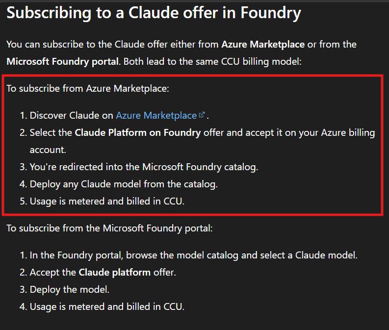

# How to Purchase Claude through Azure Marketplace

Costa Rica

 [Cloud2BR OSS - Learning Hub](https://github.com/Cloud2BR-MSFTLearningHub)

Last updated: 2026-11-16

----------

## Content

- [Overview](#overview)
- [Before You Start](#before-you-start)
- [Subscribe through Azure Marketplace](#subscribe-through-azure-marketplace)
- [Alternative: Subscribe through Microsoft Foundry](#alternative-subscribe-through-microsoft-foundry)
- [How Claude Consumption Units Work](#how-claude-consumption-units-work)
- [Discounts and Private Offers](#discounts-and-private-offers)
- [Cost and Usage Visibility](#cost-and-usage-visibility)
- [References](#references)

## Overview

This guide helps a customer discover and subscribe to the Claude Platform on Foundry offer through Azure Marketplace, deploy an available Claude model in Microsoft Foundry, and understand the Claude Consumption Unit (CCU) billing model. Subscribing from the Microsoft Foundry portal is an alternative path to the same CCU billing model.

> [!IMPORTANT]
> This is a learning guide, not a purchase recommendation. Verify current availability, prices, terms, permissions, and your organization's approval requirements before accepting an offer or deploying a model. Deployment and usage can incur charges.

## Before You Start

- Have an Azure billing account and subscription approved for marketplace purchases, and the [permissions required to subscribe to partner models](https://learn.microsoft.com/en-us/azure/foundry/foundry-models/concepts/models-from-partners#permissions-required-to-subscribe-to-models-from-partners-and-community).
- Review the [available Claude models](https://learn.microsoft.com/en-us/azure/foundry/foundry-models/concepts/claude-models#available-claude-models), hosting options, regions, and model lifecycle status for your workload.
- Confirm the offer's current terms and CCU price, and review the model's token rates at [Claude pricing](https://aka.ms/ccu-pricing).
- If your organization has negotiated pricing with Anthropic, coordinate with your Microsoft or Anthropic account team on the applicable Azure Marketplace private offer before purchasing.

## Subscribe through Azure Marketplace

1. Discover Claude on [Azure Marketplace](https://marketplace.microsoft.com/).
2. Select the **Claude Platform on Foundry** offer. Review its terms, billing account, pricing, and organizational approvals, then accept the offer.
3. Follow the redirect to the Microsoft Foundry catalog.
4. Choose an available Claude model and deploy it using the [deployment guidance](https://learn.microsoft.com/en-us/azure/foundry/foundry-models/how-to/use-foundry-models-claude).
5. Monitor usage and cost. Eligible new deployments are metered and billed in CCU through Azure Marketplace.

*Subscription paths shown in Microsoft Learn. See the [current subscription guidance](https://learn.microsoft.com/en-us/azure/foundry/foundry-models/concepts/claude-models-billing#subscribing-to-a-claude-offer-in-foundry) for updates.*

## Alternative: Subscribe through Microsoft Foundry

1. Open the Microsoft Foundry portal and browse the model catalog for a Claude model.
2. Review and accept the **Claude platform** offer.
3. Deploy the model and monitor usage; applicable new deployments use CCU billing.

## How Claude Consumption Units Work

A CCU is a unit used to invoice Claude model usage. It does not replace tokens for model calls or sizing: continue to plan for tokens per minute and requests per minute.

For each call, input and output token usage is priced at the applicable model rates. Any contractual discount is applied, then the resulting amount is converted into CCUs at the offer's fixed CCU price. CCUs are metered hourly and billed monthly in arrears through Azure Marketplace; they are not prepaid credits.

For details and examples, see [what a CCU is](https://learn.microsoft.com/en-us/azure/foundry/foundry-models/concepts/claude-models-billing#what-is-a-claude-consumption-unit) and [how tokens become CCU](https://learn.microsoft.com/en-us/azure/foundry/foundry-models/concepts/claude-models-billing#how-tokens-become-ccu). Existing deployments created before CCU became generally available can remain on their prior billing plan; consult the [migration guidance](https://learn.microsoft.com/en-us/azure/foundry/foundry-models/concepts/claude-models-billing#existing-deployments-and-migration) before moving them.

## Discounts and Private Offers

Negotiated Anthropic discounts are handled through an Azure Marketplace private offer and applied during the token-to-CCU conversion, rather than as a separate invoice discount line. Confirm the applicable terms and model-specific rates with your account team. According to the current guidance, CCU spend is eligible to decrement a Microsoft Azure Consumption Commitment (MACC); confirm your agreement and eligibility.

See [discounts and Azure Marketplace private offers](https://learn.microsoft.com/en-us/azure/foundry/foundry-models/concepts/claude-models-billing#discounts-and-azure-marketplace-private-offers).

## Cost and Usage Visibility

- Use the **Monitor** tab in Microsoft Foundry for per-model token usage and request counts. CCU-based deployments also show estimated cost.
- Use **Azure Cost Management** and your Azure invoice for actual billed cost. Foundry estimates do not reflect private-offer discounts.

For the current details, see [where to view Claude pricing, usage, and cost](https://learn.microsoft.com/en-us/azure/foundry/foundry-models/concepts/claude-models-billing#where-to-view-claude-pricing-usage-and-cost).

## References

- [Available Claude models in Microsoft Foundry](https://learn.microsoft.com/en-us/azure/foundry/foundry-models/concepts/claude-models#available-claude-models)
- [Subscribing to a Claude offer in Foundry](https://learn.microsoft.com/en-us/azure/foundry/foundry-models/concepts/claude-models-billing#subscribing-to-a-claude-offer-in-foundry)
- [Claude consumption units billing in Microsoft Foundry](https://learn.microsoft.com/en-us/azure/foundry/foundry-models/concepts/claude-models-billing)
- [Claude pricing](https://aka.ms/ccu-pricing)

<!-- START BADGE -->

  
  
Refresh Date: 2026-11-16

<!-- END BADGE -->
